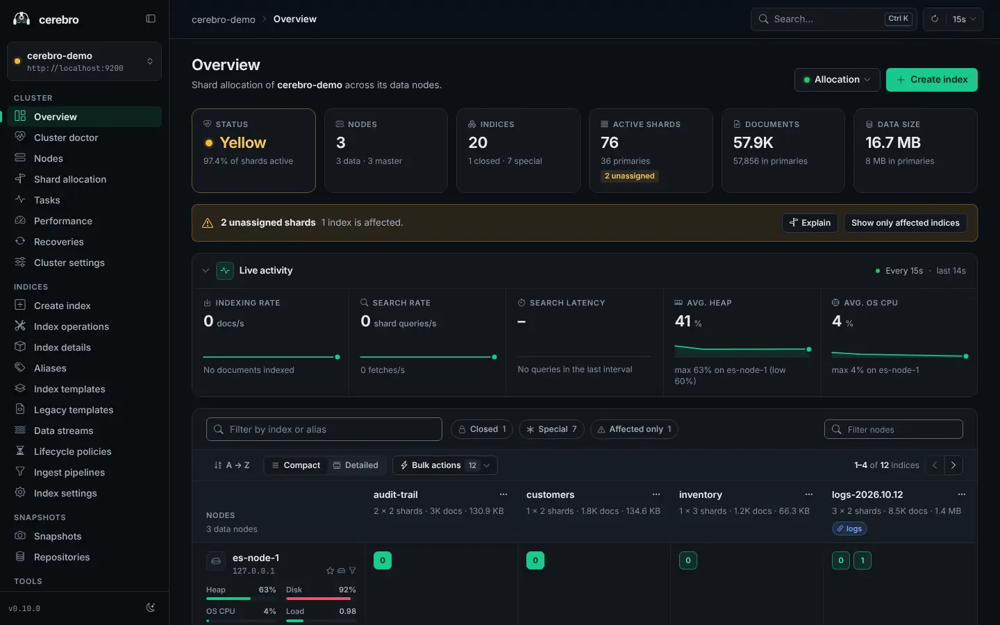
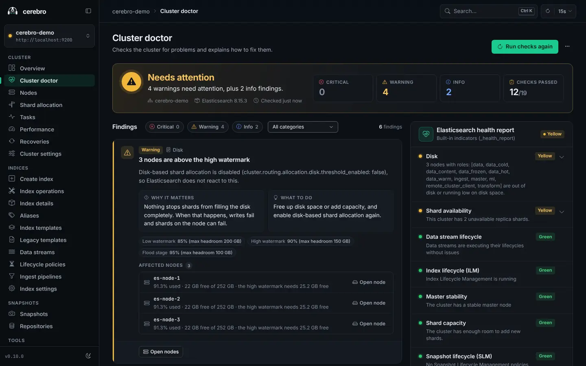
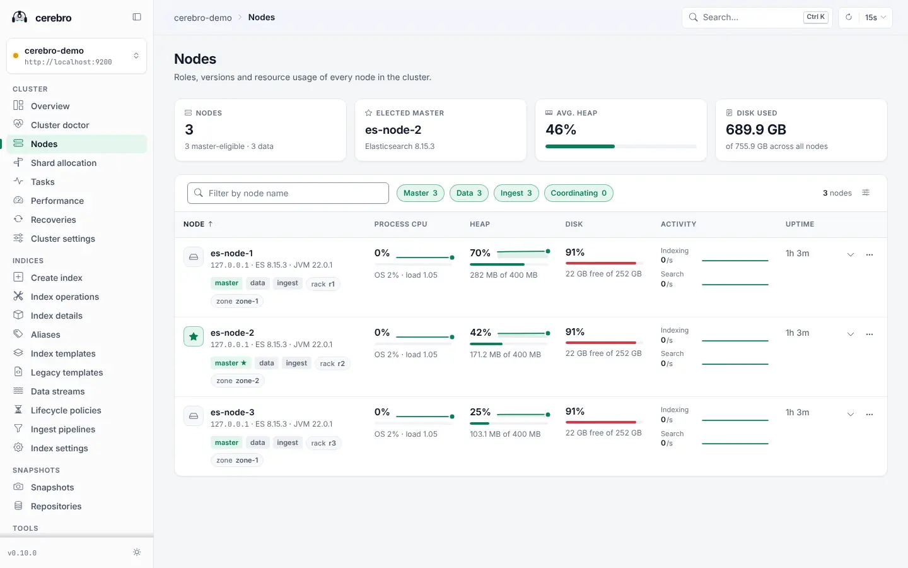
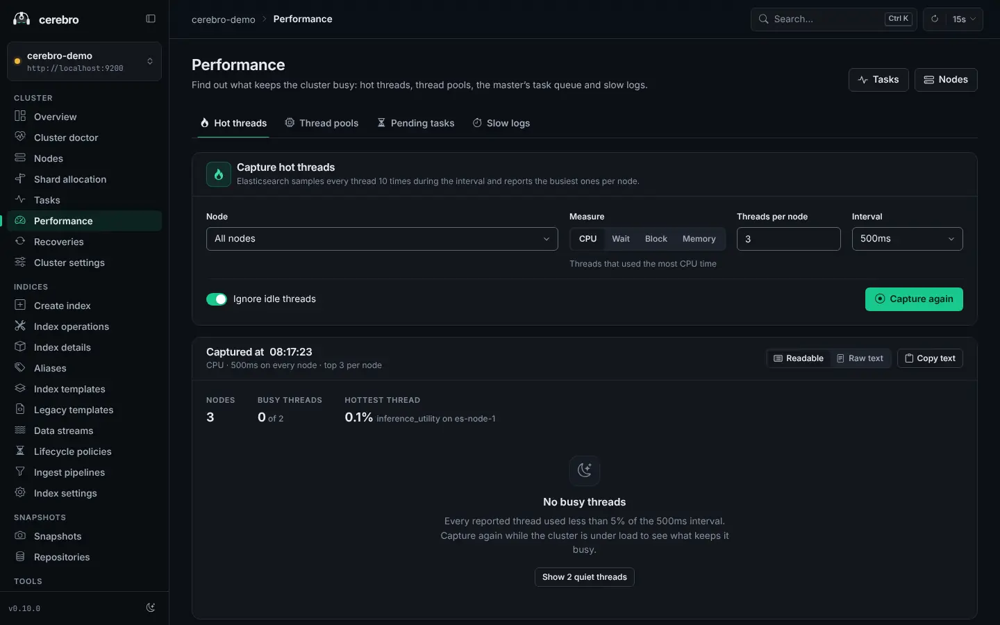
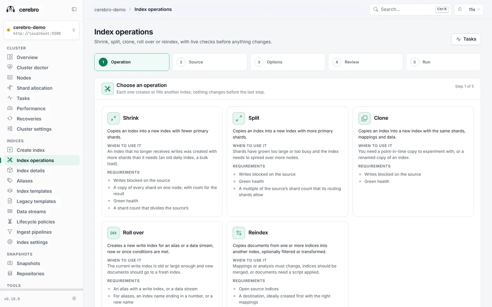
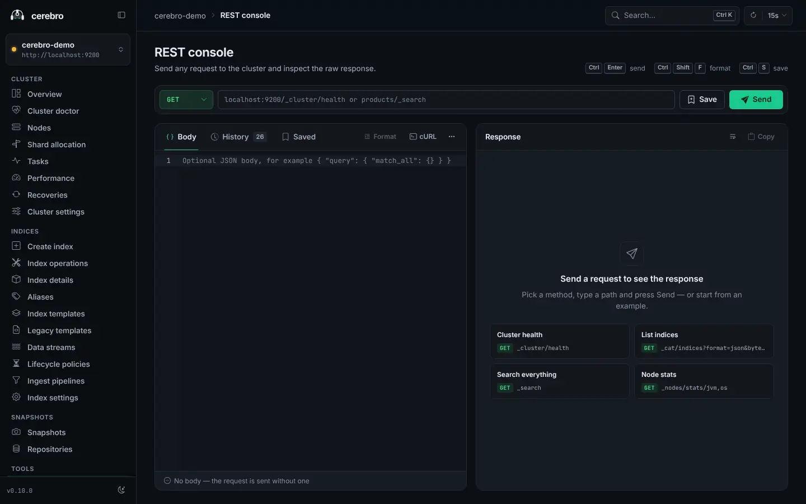
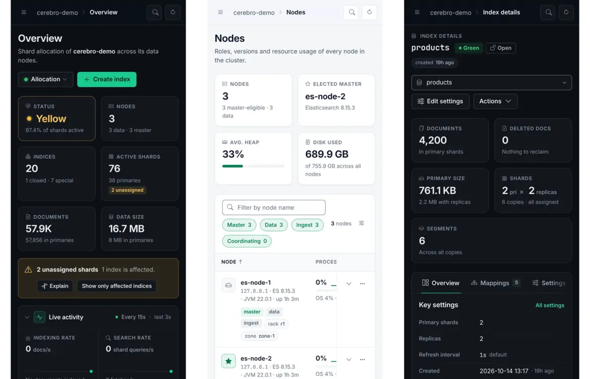

# cerebro

A web-based administration tool for Elasticsearch.

[](https://github.com/srdrcn/cerebro/actions/workflows/scala.yml)
[](https://hub.docker.com/r/chosenwar/cerebro)
[](LICENSE)

cerebro runs as a server next to your Elasticsearch clusters and gives you a
browser interface to inspect them, find problems and make changes: shards,
nodes, indices, templates, data streams, lifecycle policies, ingest pipelines,
snapshots and a REST console. The server is built with Scala and Play
Framework, the web interface with Angular.

This repository is a fork of [lmenezes/cerebro](https://github.com/lmenezes/cerebro)
by Leonardo Menezes. The web interface was rewritten from scratch and many
pages were added. See [License and credits](#license-and-credits).



<table>
  <tr>
    <td align="center" width="33%">
      <a href="docs/screenshots/doctor.webp"></a>
      <br>Cluster doctor
    </td>
    <td align="center" width="33%">
      <a href="docs/screenshots/nodes.webp"></a>
      <br>Nodes
    </td>
    <td align="center" width="33%">
      <a href="docs/screenshots/performance.webp"></a>
      <br>Performance
    </td>
  </tr>
  <tr>
    <td align="center" width="33%">
      <a href="docs/screenshots/index-ops.webp"></a>
      <br>Index operations
    </td>
    <td align="center" width="33%">
      <a href="docs/screenshots/rest.webp"></a>
      <br>REST console
    </td>
    <td align="center" width="33%">
      <a href="docs/screenshots/mobile.webp"></a>
      <br>Phone layouts
    </td>
  </tr>
</table>

## Contents

- [Features](#features)
- [Quick start with Docker](#quick-start-with-docker)
- [Docker image](#docker-image)
- [Install from a release package](#install-from-a-release-package)
- [Upgrading from lmenezes/cerebro](#upgrading-from-lmenezescerebro)
- [Connecting to clusters](#connecting-to-clusters)
- [Configuration](#configuration)
- [Authentication](#authentication)
- [Compatibility](#compatibility)
- [Building from source](#building-from-source)
- [Contributing](#contributing)
- [Security](#security)
- [Changelog](#changelog)
- [License and credits](#license-and-credits)

## Features

### Cluster

- **Overview**: cluster health and totals, and a shard map of every index on
  every node. Open, close, refresh, flush, force merge, clear the cache of and
  delete one index or all filtered indices. Move shards between nodes, and
  enable or disable shard allocation. Live charts show indexing and search
  rates, search latency, heap and CPU.
- **Cluster doctor**: a one-click health check. It looks for unassigned
  shards, replicas that can never be allocated, indices without replicas,
  nodes above the disk watermarks, read-only blocks, oversized and
  over-sharded indices, the shard limit, ILM errors, heap and garbage
  collection pressure, tripped circuit breakers, disabled allocation,
  transient settings and upgrade deprecations. Each finding explains why it
  matters and offers a fix (applied only after you confirm it) or a link to the
  page that handles it. On Elasticsearch 8.7 and later it also shows
  Elasticsearch's own health report.
- **Nodes**: roles, versions, heap, disk, CPU and load of every node, with
  per-node activity charts, thread pool queues and rejections.
- **Shard allocation**: why a shard is unassigned or stays on its node, with
  the decision of every node.
- **Tasks**: running tasks with their sub-tasks, task details, and
  cancellation of tasks that can be canceled.
- **Performance**: hot threads in a readable form, live thread pools, the
  master's pending tasks, and a slow log threshold editor with presets.
- **Recoveries**: live progress of shard recoveries.
- **Cluster settings**: view and edit persistent and transient settings.

### Indices

- **Create index**, optionally copying the settings and mappings of an
  existing index.
- **Index operations**: a wizard for shrink, split, clone, rollover and
  reindex. It checks the requirements live (write block, shard placement,
  disk space, document limits, valid shard counts), shows the exact requests
  before it sends them and tracks their progress.
- **Index details**: overview, settings, mappings, statistics, aliases, shards
  and lifecycle of one index.
- **Index settings**: edit the settings of an index.
- **Aliases**: add and remove aliases, including filters, routing, the write
  index and the hidden flag.

### Data management

- **Index templates**: composable index templates and component templates,
  with a preview of the settings, mappings and aliases a template resolves
  to. Legacy templates (`_template`) have their own page.
- **Data streams**: backing indices, generation, lifecycle, rollover and
  deletion.
- **Lifecycle policies (ILM)**: policies with a phase timeline and a JSON
  editor, the lifecycle status of each index, and a retry for failed steps.
- **Ingest pipelines**: edit, delete and simulate pipelines against sample
  documents, with the result of every processor.
- **Snapshots and repositories**: create, restore and delete snapshots;
  create and delete repositories (`fs`, `url`, `s3`, `gcs`, `azure` and
  `hdfs`).

### Tools

- **REST console**: send any request with a JSON editor. The history is kept
  on the server: the last 50 requests per signed-in user by default. Without
  authentication, everyone using the instance shares one history. Saved requests
  are kept in the browser and can be exported and imported as JSON.
  "Copy as cURL" copies a request without its credentials.
- **Analysis**: see the tokens that an index analyzer or a field's analyzer
  produces for a text.
- **CAT APIs**: browse the `_cat` APIs as tables.

### Interface

- Light and dark themes. The theme follows the operating system by default.
- A command palette (`Ctrl`+`K`, or `⌘`+`K` on macOS) to jump to any page,
  action or index.
- Layouts that work down to phone width.
- Auto-refresh with a choice of interval. It can be paused and does not poll
  while the browser tab is hidden.
- Notifications when nodes join or leave the cluster and when indices are
  created or deleted. Changes you make yourself in the same browser tab when
  you create or delete an index, restore a snapshot or run an index operation
  are not announced again. Other changes, such as a request sent from the
  REST console or a change made in another tab, are announced.
- Links carry the cluster (`?host=`), so every page can be bookmarked. Links
  in the `#!/` format of older cerebro versions still open the right page.
- Keyboard support, a visible focus ring and WCAG AA text contrast in both
  themes.

## Quick start with Docker

```sh
docker run -d --name cerebro \
  -p 9000:9000 \
  -v cerebro-data:/var/lib/cerebro \
  -e CEREBRO_SECRET="$(openssl rand -base64 48)" \
  chosenwar/cerebro:latest
```

Open <http://localhost:9000> and enter the address of an Elasticsearch node.

- `CEREBRO_SECRET` is required: cerebro uses it to sign its session cookie and
  does not start without it. Use a random value of at least 32 characters.
  A new secret signs everyone out, so in production keep one value and reuse
  it.
- The volume keeps the REST console history
  (`/var/lib/cerebro/cerebro.db`). If you mount a host directory instead, it
  must be writable by UID 65532.
- The cerebro server, not your browser, connects to Elasticsearch. Inside a
  container, `localhost` is the container itself, so enter an address that the
  container can reach.
- If people open cerebro under any host name or IP address other than
  `localhost`, `127.0.0.1` or a `.local` name (for example
  `http://10.0.0.5:9000`), set `CEREBRO_ALLOWED_HOST` (see
  [Reverse proxy and HTTPS](#reverse-proxy-and-https)).

### Docker Compose examples

The [examples](examples) folder has Docker Compose files that use
`chosenwar/cerebro:latest`:

| Example | What it shows |
| --- | --- |
| [examples/basic_auth](examples/basic_auth) | Sign-in with one user name and password (`admin` / `admin`) |
| [examples/open_ldap](examples/open_ldap) | LDAP sign-in against an OpenLDAP container |
| [examples/open_ldap_group](examples/open_ldap_group) | LDAP sign-in with a group membership check |

```sh
cd examples/basic_auth
docker compose up -d
```

The examples use a placeholder secret and test passwords. Replace them before
you use the files for anything else.

## Docker image

The image is published on Docker Hub as
[chosenwar/cerebro](https://hub.docker.com/r/chosenwar/cerebro).

### Tags

| Tag | Content | Changes over time |
| --- | --- | --- |
| `latest` | The newest commit on `main` that passed CI | Yes, with every push to `main` |
| `sha-<commit>` | One commit on `main` (short commit hash) | No |
| `X.Y.Z`, for example `0.10.0` | The release tagged `vX.Y.Z` | No |
| `X.Y`, for example `0.10` | The newest `X.Y.*` release | Yes, with each patch release |

`latest` follows `main`, not the newest release. Pin an `X.Y.Z` tag for
production.

There is no release yet; the first one will be v0.10.0. Until then, use
`latest` or a `sha-<commit>` tag, or build the image yourself.

### Image details

- Platforms: `linux/amd64` and `linux/arm64`.
- Runtime: Wolfi with OpenJDK 17. The base packages are upgraded when the
  image is built, so it includes the OS security fixes released since the
  pinned base image.
- Runs as the non-root user UID/GID `65532`.
- Listens on port `9000` (`CEREBRO_PORT`) and stores its data in the volume
  `/var/lib/cerebro`.
- The JVM may use up to 75% of the memory available to the container for its
  heap, and exits on an `OutOfMemoryError` so that the container can be
  restarted.
- Images pushed by CI carry SBOM and provenance attestations. You can read
  them with Docker Buildx:

  ```sh
  docker buildx imagetools inspect chosenwar/cerebro:latest --format '{{ json .SBOM }}'
  docker buildx imagetools inspect chosenwar/cerebro:latest --format '{{ json .Provenance }}'
  ```

### How images are checked

Every pull request to `main`, every push to `main` and every version tag runs
the [build-and-security](.github/workflows/scala.yml) workflow. Its `verify`
job:

1. type-checks, tests and builds the web interface;
2. audits the complete npm dependency tree and fails on any advisory of high
   or critical severity;
3. checks that no code from the old AngularJS and Bootstrap 3 interface is
   packaged;
4. runs the backend tests and packages the server;
5. scans the packaged Java libraries with Trivy;
6. builds the `linux/amd64` and `linux/arm64` images and scans each one with
   Trivy.

All three Trivy scans report every severity, including vulnerabilities
without a fix, and any finding fails the build. The image scans also fail if
the operating system has reached its end of life.

Images are pushed to Docker Hub only after `verify` passes, and only for
pushes to this repository (`main` and version tags).

### Build the image yourself

```sh
docker build -t cerebro:local .
```

The [Dockerfile](Dockerfile) builds the web interface and the server and runs
the frontend and backend tests during the build.

## Install from a release package

Each [GitHub release](https://github.com/srdrcn/cerebro/releases) has two
server packages: `cerebro-X.Y.Z.zip` and `cerebro-X.Y.Z.tgz`. They need Java
17 or newer.

There is no release yet; the first one will be v0.10.0. Until then, use the
Docker image or [build from source](#building-from-source).

```sh
unzip cerebro-X.Y.Z.zip
cd cerebro-X.Y.Z
export CEREBRO_SECRET="$(openssl rand -base64 48)"
bin/cerebro
```

On Windows, set the `CEREBRO_SECRET` environment variable and run
`bin\cerebro.bat`.

Then open <http://localhost:9000>. Java system properties can be passed on
the command line, for example:

```sh
bin/cerebro -Dhttp.port=1234 -Dhttp.address=127.0.0.1
bin/cerebro -Ddata.path=/var/lib/cerebro/cerebro.db
```

## Upgrading from lmenezes/cerebro

This version can replace the original cerebro from
[lmenezes/cerebro](https://github.com/lmenezes/cerebro), but some things have
changed:

- **Application secret.** The configuration files of the original project set
  the secret with the key `secret`. This version does not read that key. Set
  `CEREBRO_SECRET` (or `-Dplay.http.secret.key`). Without it, the release
  packages and the Docker image do not start, even with an old configuration
  file that sets `secret`.
- **Configuration file.** Start from the new
  [conf/application.conf](conf/application.conf) and copy over your `hosts`
  list, your `auth` settings if you set them in the file, and any other
  setting you changed. The new file reads the variables listed in
  [Environment variables](#environment-variables).
- **Docker image.** The image is
  [chosenwar/cerebro](https://hub.docker.com/r/chosenwar/cerebro). It runs as
  UID/GID `65532` and keeps the REST console history in the volume
  `/var/lib/cerebro` (`/var/lib/cerebro/cerebro.db`). Files that you mount
  must be readable by that user, and a host directory mounted at
  `/var/lib/cerebro` must be writable by it.
- **Packages.** Releases publish the `.zip` and `.tgz` packages and the Docker
  image only. There are no Debian, RPM or Chocolatey packages of this version.
  The packages need Java 17 or newer.
- **Bookmarks.** Links in the `#!/` format of the original interface still
  open the right page.

## Connecting to clusters

The connect page offers three ways to reach a cluster:

- **Configured clusters**: the clusters listed under `hosts` in the
  configuration file.
- **Recent**: up to five addresses you connected to recently that are not
  configured clusters. They are stored in the browser, never with
  credentials, and you can remove each one.
- **Node address**: any address, such as `http://localhost:9200` or
  `https://es.example.com:9200`.

If the cluster answers with `401 Unauthorized`, cerebro asks for a user name
and password. They are kept in memory for that browser tab only. cerebro sends
them with each request to Elasticsearch, using HTTP Basic authentication.

All requests to Elasticsearch are made by the cerebro server, so the address
must be reachable from where cerebro runs.

### Configured clusters

List your clusters in `conf/application.conf`:

```hocon
hosts = [
  {
    host = "http://localhost:9200"
    name = "Local cluster"
  }
  {
    host = "https://es.example.com:9200"
    name = "Production"
    auth = {
      username = "cerebro"
      password = "secret-password"
    }
  }
]
```

| Key | Description |
| --- | --- |
| `host` | Base URL of the cluster. Required. |
| `name` | Name shown on the connect page. Defaults to `host`. |
| `auth.username`, `auth.password` | Credentials the server uses for this cluster. The browser only sends the cluster's name; the server looks up the address and credentials. When set, they are used instead of credentials entered in the browser. |
| `headers-whitelist` | Request headers that cerebro copies from the browser's request to every request to this cluster, for example `[ "x-proxy-user", "x-proxy-roles", "X-Forwarded-For" ]` when a proxy in front of cerebro sets them. |

To use this list with the Docker image, mount your own configuration file
(see [Other settings](#other-settings)).

## Configuration

The release package reads `conf/application.conf`; the Docker image has the
same file at `/opt/cerebro/conf/application.conf`. The security, port and
authentication settings can be set with environment variables. The other
settings are set in the file or as Java system properties (`-Dkey=value`).
Defaults that also apply when you use a configuration file of your own are in
`conf/reference.conf`.

### Environment variables

| Variable | Default | Description |
| --- | --- | --- |
| `CEREBRO_SECRET` | None; required in production | Application secret (`play.http.secret.key`). Signs the session cookie. Use a random value of at least 32 characters. |
| `CEREBRO_COOKIE_SECURE` | `false` | Set to `true` when cerebro is served over HTTPS. Browsers then send the session cookie only over HTTPS. |
| `CEREBRO_ALLOWED_HOST` | Not set | Adds one entry to Play's allowed hosts (`play.filters.hosts.allowed`). Needed when people open cerebro under any host name or IP address other than `localhost`, `127.0.0.1` or a `.local` name. |
| `CEREBRO_PORT` | `9000` | HTTP port (`play.server.http.port`). |
| `AUTH_TYPE` | Not set (no sign-in) | `basic` or `ldap`. See [Authentication](#authentication). |
| `BASIC_AUTH_USER` | | User name for `basic`. Required for `basic`. |
| `BASIC_AUTH_PWD` | | Password for `basic`. Required for `basic`. |
| `LDAP_URL` | | LDAP server, for example `ldap://ldap.example.com:389`. Required for `ldap`. |
| `LDAP_BASE_DN` | | Base DN of the users. It is the second `%s` in `LDAP_USER_TEMPLATE`. Required for `ldap`. |
| `LDAP_METHOD` | | Authentication method, usually `simple`; otherwise the SASL mechanisms to try. Required for `ldap`. |
| `LDAP_USER_TEMPLATE` | | Turns the user name typed at sign-in into the name cerebro binds with. The first `%s` is the user name, the second `LDAP_BASE_DN`. Examples: `%s`, `%s@example.com`, `uid=%s,%s`. Required for `ldap`. |
| `LDAP_BIND_DN` | | Account that searches for group membership. Required when `LDAP_GROUP` is set. |
| `LDAP_BIND_PWD` | | Password of `LDAP_BIND_DN`. Required when `LDAP_GROUP` is set. |
| `LDAP_GROUP_BASE_DN` | `LDAP_BASE_DN` | Where the group membership search starts. |
| `LDAP_USER_ATTR` | | Attribute that identifies the user, for example `uid` or `mail`. Required when `LDAP_GROUP` is set. |
| `LDAP_USER_ATTR_TEMPLATE` | `LDAP_USER_TEMPLATE` | Turns the user name into the value of `LDAP_USER_ATTR`. |
| `LDAP_GROUP` | Not set (no group check) | LDAP filter that an entry below `LDAP_GROUP_BASE_DN` must match together with `LDAP_USER_ATTR` (see [LDAP](#ldap)), for example `memberof=cn=cerebro,ou=groups,dc=example,dc=com`. |

### HTTP address and port

cerebro listens on `0.0.0.0:9000` by default. Change the port with
`CEREBRO_PORT` or `-Dhttp.port`, and the address with `-Dhttp.address`:

```sh
bin/cerebro -Dhttp.port=1234 -Dhttp.address=127.0.0.1
```

`CEREBRO_PORT` takes precedence over `-Dhttp.port`. The Docker image sets
`CEREBRO_PORT=9000`.

### Other settings

These keys are set in `conf/application.conf`:

| Key | Default | Description |
| --- | --- | --- |
| `hosts` | `[]` | Configured clusters. See [Configured clusters](#configured-clusters). |
| `basePath` | `"/"` | Path under which cerebro is served. See [Base path](#base-path). |
| `data.path` | `"./cerebro.db"` | SQLite database that stores the REST console history. The Docker image uses `/var/lib/cerebro/cerebro.db`. |
| `rest.history.size` | `50` | Number of REST console history entries kept per user. |
| `es.gzip` | `true` | Ask Elasticsearch for compressed responses (`play.ws.compressionEnabled`). `conf/reference.conf` sets `false`; `conf/application.conf` sets `true`. |
| `pidfile.path` | `/dev/null` | Where to write the process ID file. `/dev/null` writes none. |
| `auth` | From the environment | Authentication settings. The environment variables above fill them in. |

To use a configuration file in another location, pass `config.file`:

```sh
bin/cerebro -Dconfig.file=/some/other/dir/alternate.conf
```

That file replaces `conf/application.conf`, while `conf/reference.conf` still
applies (application secret, cookie flags, allowed host, database and base
path). Start from a copy of `conf/application.conf` so that the environment
variables keep working.

With the Docker image, mount the file and pass the option through
`JAVA_TOOL_OPTIONS`:

```sh
docker run -d --name cerebro \
  -p 9000:9000 \
  -v cerebro-data:/var/lib/cerebro \
  -v "$PWD/application.conf:/etc/cerebro/application.conf:ro" \
  -e JAVA_TOOL_OPTIONS="-Dconfig.file=/etc/cerebro/application.conf" \
  -e CEREBRO_SECRET \
  chosenwar/cerebro:latest
```

`-e CEREBRO_SECRET` without a value passes the variable from your shell, so
export it first.

### Base path

To serve cerebro under a path such as `https://example.com/cerebro/`, set
`basePath` to that path with a leading and a trailing slash:

```sh
bin/cerebro -DbasePath=/cerebro/
```

`basePath` sets Play's `play.http.context`. A reverse proxy in front of
cerebro must forward the path unchanged, including the `/cerebro/` prefix.

### Reverse proxy and HTTPS

When cerebro runs behind a reverse proxy or a load balancer:

- Set `CEREBRO_COOKIE_SECURE=true` when people reach cerebro over HTTPS.
- Set `CEREBRO_ALLOWED_HOST` to the host name or IP address people use, for
  example `cerebro.example.com` or `10.0.0.5`. Play's allowed hosts filter
  rejects requests for hosts that are not allowed. A leading dot (`.example.com`) allows the domain
  and all its subdomains. The variable adds one entry; to allow more, add them
  to `play.filters.hosts.allowed` in a configuration file.
- Set `basePath` if cerebro is served under a path (see [Base path](#base-path)).
- Turn on authentication (see below) for any instance that other people can
  reach.

## Authentication

Without `AUTH_TYPE`, there is no sign-in: anyone who can open cerebro can use
it, with every cluster it can reach, including any address typed on the
connect page. Set `AUTH_TYPE` to `basic` or `ldap` to require sign-in. Signed-in
users get a session cookie and can sign out from the sidebar.

This protects cerebro itself. Access to Elasticsearch is configured
separately (see [Connecting to clusters](#connecting-to-clusters)).

### Basic

One user name and password, checked on cerebro's sign-in page:

```sh
docker run -d --name cerebro \
  -p 9000:9000 \
  -v cerebro-data:/var/lib/cerebro \
  -e CEREBRO_SECRET="$(openssl rand -base64 48)" \
  -e AUTH_TYPE=basic \
  -e BASIC_AUTH_USER=admin \
  -e BASIC_AUTH_PWD='choose-a-strong-password' \
  chosenwar/cerebro:latest
```

### LDAP

cerebro signs a user in by binding to the LDAP server as that user.
`LDAP_USER_TEMPLATE` builds the bind name from the user name typed at sign-in
and `LDAP_BASE_DN`.

If `LDAP_GROUP` is set, cerebro also checks group membership. It binds as
`LDAP_BIND_DN`, searches below `LDAP_GROUP_BASE_DN` (or `LDAP_BASE_DN`) for an
entry that matches both conditions of this filter, and lets the user in only
if it finds one:

```text
(&(<LDAP_USER_ATTR>=<value from LDAP_USER_ATTR_TEMPLATE>)(<LDAP_GROUP>))
```

With Docker, you can keep the settings in an environment file, for example
`ldap.env`:

```dotenv
# Application secret: a random value of at least 32 characters
CEREBRO_SECRET=replace-with-a-random-value-of-at-least-32-characters

AUTH_TYPE=ldap
LDAP_URL=ldap://ldap.example.com:389
LDAP_BASE_DN=ou=people,dc=example,dc=com
LDAP_METHOD=simple

# The first %s is the user name, the second LDAP_BASE_DN:
# a user "jane" binds as uid=jane,ou=people,dc=example,dc=com
LDAP_USER_TEMPLATE=uid=%s,%s

# Optional group membership check. Without LDAP_GROUP there is no group check.
LDAP_BIND_DN=cn=admin,dc=example,dc=com
LDAP_BIND_PWD=replace-with-the-bind-password
LDAP_USER_ATTR=uid
LDAP_USER_ATTR_TEMPLATE=%s
LDAP_GROUP=memberof=cn=cerebro,ou=groups,dc=example,dc=com
# Defaults to LDAP_BASE_DN:
# LDAP_GROUP_BASE_DN=ou=people,dc=example,dc=com
```

```sh
docker run -d --name cerebro \
  -p 9000:9000 \
  -v cerebro-data:/var/lib/cerebro \
  --env-file ldap.env \
  chosenwar/cerebro:latest
```

For Active Directory, a common setup binds with the user principal name
(`LDAP_USER_TEMPLATE=%s@example.com`), identifies users with
`LDAP_USER_ATTR=userPrincipalName` (the attribute template then defaults to
the same `%s@example.com`) and checks a group with a filter such as
`LDAP_GROUP=memberOf=CN=cerebro,OU=groups,DC=example,DC=com`.

The [OpenLDAP example](examples/open_ldap/README.md) and the
[OpenLDAP group example](examples/open_ldap_group/README.md) walk through
sign-in without and with a group check, using a test OpenLDAP server.

## Compatibility

- **Elasticsearch**: this version was developed against Elasticsearch 8.15,
  and the test data for the new pages was captured from an 8.15.3 cluster.
  The code also handles the responses of older 7.x and 8.x versions where they
  are known to differ, but those versions are not tested as a whole.
  Elasticsearch 9 and OpenSearch are not covered by the tests. If you use
  cerebro with another version, please report what works and what does not.
- Some features need a minimum version. cerebro tells you when a cluster or
  an index does not meet it:

  | Feature | Needs |
  | --- | --- |
  | Composable index templates and component templates | Elasticsearch 7.8 or later |
  | Data streams | Elasticsearch 7.9 or later |
  | Cluster doctor: Elasticsearch health report | Elasticsearch 8.7 or later |
  | Cluster doctor: upgrade deprecations | Elasticsearch 7.0 or later |
  | Shrink, split or clone a closed index without opening it | An index created by Elasticsearch 7.2 or later |

- **Secured clusters**: cerebro connects with a user name and password (HTTP
  Basic authentication) and can do only what that user's roles allow. The
  cluster doctor lists the checks it could not run because of a missing
  privilege.
- **Java**: the server needs Java 17 or newer.

## Building from source

You need:

- a JDK, version 17 or newer, and [sbt](https://www.scala-sbt.org/);
- Node.js `^22.22.3`, `^24.15.0` or `>=26.0.0`, with npm 10 or newer.

Build the web interface first, then the server:

```sh
git clone https://github.com/srdrcn/cerebro.git
cd cerebro
npm ci
npm run build
sbt stage
CEREBRO_SECRET="$(openssl rand -base64 48)" target/universal/stage/bin/cerebro
```

`npm run build` writes the browser bundle to `public/js`, which Play packages
with the server. `public/js` is build output and is not kept in git, so run
`npm run build` (or `npm start`) before `sbt run` or `sbt stage`.

The checks that CI runs:

```sh
npm run typecheck   # type-check the frontend
npm test            # frontend tests (Vitest)
npm run audit       # npm audit gate (audit-ci)
sbt test            # backend tests
```

To build the `.zip` and `.tgz` packages in `target/universal/`:

```sh
sbt Universal/packageBin Universal/packageZipTarball
```

For development, run the Angular build in watch mode in one terminal and the
Play development server in another, then open <http://localhost:9000>:

```sh
npm start
```

```sh
sbt run
```

The architecture of the web interface and its design system are described in
[docs/FRONTEND.md](docs/FRONTEND.md).

## Contributing

Bug reports, documentation fixes and pull requests are welcome. Please read
[CONTRIBUTING.md](CONTRIBUTING.md) first. Everyone who takes part is expected
to follow the [Code of Conduct](CODE_OF_CONDUCT.md).

## Security

Please do not report security problems in public issues. Use GitHub's
private vulnerability reporting instead: open the **Security** tab of this
repository and choose **Report a vulnerability**, or go directly to
<https://github.com/srdrcn/cerebro/security/advisories/new>.

Security fixes go into `main` and into the next release. See
[SECURITY.md](SECURITY.md) for the supported versions, what to include in a
report and what to expect.

## Changelog

[CHANGES.md](CHANGES.md) lists the changes in every version. The entries up
to v0.9.4 are from the original project; the entries after it describe this
fork. The notes of each GitHub release are taken from its section of
CHANGES.md.

## License and credits

cerebro is released under the [MIT License](LICENSE).

cerebro was created by [Leonardo Menezes](https://github.com/lmenezes) in
[lmenezes/cerebro](https://github.com/lmenezes/cerebro). The copyright notice
in [LICENSE](LICENSE) is his and is kept unchanged. This fork moved the server
to Play 3 and Java 17, rewrote the web interface in Angular and added many of
the pages described above.

cerebro is built with [Play Framework](https://www.playframework.com/),
[Apache Pekko](https://pekko.apache.org/), [Slick](https://scala-slick.org/),
[SQLite](https://sqlite.org/), [Angular](https://angular.dev/), the
[Ace](https://ace.c9.io/) editor, [Bootstrap Icons](https://icons.getbootstrap.com/)
and the [Inter](https://rsms.me/inter/) and
[JetBrains Mono](https://www.jetbrains.com/lp/mono/) fonts.
